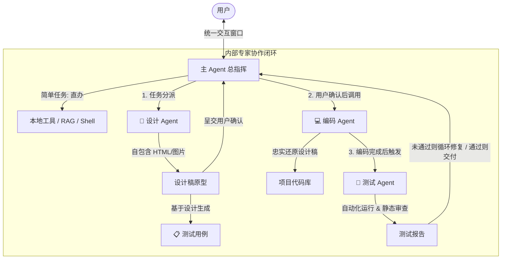

# 🤖 Code Agent - 全栈工程智能体 (Multi-Agent Architecture)

基于 **LangGraph**、**LangChain**、**Qdrant 混合代码 RAG** 与 **Gradio** 构建的全栈多 Agent 协同软件工程智能体系统。

系统采用「**主 Agent 调度 + 内部专家子 Agent 协作**」架构。主 Agent 作为与用户的唯一交互窗口，简单任务直接处理，复杂任务自动流转分派给**设计**、**编码**、**测试** 3 个子 Agent，全流程对用户呈现高保真原型确认、测试用例追踪与自动化测试报告。

---

## 🌟 核心特性

- 🎯 **主从多 Agent 协同架构**：
  - **主 Agent（Orchestrator）**：与用户交流的唯一窗口，负责意图识别与任务复杂度分流；简单任务秒级直办，复杂任务调度内部团队。
  - **🎨 设计 Agent（Design Sub-Agent）**：分析需求，生成单文件自包含的高保真 HTML 原型页面（或 SVG/图片）展示在沙箱 iframe 中供用户确认。
  - **📋 测试 Agent（Test Case & Testing Sub-Agent）**：设计完成后基于设计稿同步生成详尽测试用例；编码完成后执行自动化测试并输出测试报告（支持测试未通过时的多轮自愈修复）。
  - **💻 编码 Agent（Coding Sub-Agent）**：在用户明确确认设计后才介入，忠实还原设计稿，生成零缺陷、可执行的代码。
- ⚡ **对用户透明的子 Agent 机制**：子 Agent 的复杂执行过程打上沙箱标签，在界面上以优雅的工作阶段卡片（Stage Card）与实时微动效进度呈现，不产生冗长噪音。
- ⚙️ **多 Agent 独立模型配置**：每个 Agent（主/设计/编码/测试）均支持配置独立的模型（Provider、Model、Base URL、API Key、Temperature），可在 Gradio 界面或 `.env` 环境变量中独立定制。
- 📚 **混合代码 RAG 知识库**：结合 Tree-sitter AST 代码符号分割、Qdrant 向量检索与 BM25 全文检索，支持毫秒级代码指纹增量热同步。
- 💬 **持久化会话与记忆压缩**：会话历史基于 SQLite 检查点持久化存储，支持自动自愈孤立工具调用，并在上下文过长时自动触发滑动窗口记忆摘要压缩。
- 🎨 **现代化双栏沉浸式界面**：左侧提供对话控制台与历史会话管理，右侧实时提供「设计原型沙箱预览」、「测试用例清单」与「测试报告」选项卡联动展示。

---

## 📐 架构与工作流



---

## 📂 项目结构

```text
lc_agent/
├── data/                       # 本地数据库与向量索引存储目录
├── skills/                     # 渐进式专家技能库 (SOP)
├── src/                        # 核心源代码
│   ├── agent/                  # Agent 核心逻辑
│   │   ├── main_agent.py       # 主调度 Agent 定义与工作区上下文注入
│   │   ├── delegation.py       # 阶段委派工具 (delegate_design / coding / testing)
│   │   ├── model_config.py     # 各 Agent 独立模型配置中心与优先级解析
│   │   ├── workflow.py         # 跨 Agent 工作流状态管理与产物路径约定
│   │   ├── graph_builder.py    # 通用 LangGraph 循环状态图构建器
│   │   ├── healing.py          # 历史会话孤立工具调用的自愈修复
│   │   ├── memory.py           # 会话记忆管理与 Token 滑动窗口摘要压缩
│   │   ├── session_manager.py  # SQLite 会话元数据持久化
│   │   └── subagents/          # 内部专家子 Agent 模块
│   │       ├── base.py         # 子 Agent 独立沙箱运行器 (TAG_NOSTREAM)
│   │       ├── design.py       # 设计子 Agent
│   │       ├── coding.py       # 编码子 Agent
│   │       └── testing.py      # 测试子 Agent (用例生成 & 测试执行)
│   ├── prompt/                 # 提示词工程 (模块化拆分)
│   │   ├── common.py           # 共通约束、工具准则与工作区描述
│   │   ├── main_prompt.py      # 主 Agent 系统提示词
│   │   ├── design_prompt.py    # 设计 Agent 系统提示词
│   │   ├── coding_prompt.py    # 编码 Agent 系统提示词
│   │   └── testing_prompt.py   # 测试 Agent 系统提示词
│   ├── rag/                    # AST 代码符号解析与混合检索系统
│   ├── tools/                  # 本地命令行与 RAG 检索工具
│   ├── mcp_tools/              # MCP 工具协议适配
│   ├── ui/                     # Gradio 前端展示层
│   │   ├── model_config_ui.py  # 多 Agent 独立模型配置折叠面板
│   │   ├── design_panel.py     # 设计稿 iframe 原型与测试报告展示面板
│   │   ├── predict_handler.py  # 流式回复与实时进度状态推送
│   │   ├── session_view.py     # 历史消息与阶段卡片渲染
│   │   └── workspace.py        # 本地工作区文件夹绑定与索引同步
│   ├── app.py                  # Gradio 应用主启动入口
│   ├── script.js               # 前端全屏切换与交互脚本
│   └── style.css               # 现代化界面主题与阶段卡片样式
├── .env.example                # 环境变量配置模板
├── pyproject.toml              # 项目依赖与 Python 环境配置
└── README.md                   # 项目使用与架构说明
```

---

## 🚀 快速上手

### 1. 环境准备

推荐使用 Python 3.12 版本：

```bash
# 激活本地虚拟环境
.venv\Scripts\activate   # Windows
# source .venv/bin/activate  # Linux / macOS
```

### 2. 配置环境变量

复制 `.env.example` 为 `.env` 并填写相关模型参数：

```bash
cp .env.example .env
```

在 `.env` 中至少配置基础的大模型凭证：

```ini
OPENAI_API_KEY=sk-your-openai-api-key
OPENAI_BASE_URL=https://api.openai.com/v1
OPENAI_MODEL=gpt-4o

# 数据持久化目录（必填）
QDRANT_PATH=./data/qdrant
DB_PATH=./data/sqlite3
```

> **提示**：系统支持为每个子 Agent 单独配置不同模型。详见下文「模型配置指南」。

### 3. 启动应用

运行应用启动脚本：

```bash
python src/app.py
```

终端将打印本地服务地址（默认 `http://127.0.0.1:7860`），在浏览器打开即可进入 Code Agent 控制台。

---

## 🛠️ 模型配置指南

系统支持**三层优先级**的模型配置，优先级由高到低为：

1. **Gradio 界面覆盖配置**：在页面顶部点击展开「⚙️ 多 Agent 独立模型配置」进行修改并保存，修改后即刻生效，持久化保存在 `data/agent_models.json`；
2. **`.env` 中角色专属配置**：为特定 Agent 单独指定的配置；
3. **`.env` 中全局默认配置**：所有未填项自动继承的全局 `OPENAI_*`。

### 各 Agent 环境变量速查

| Agent 角色 | 推荐模型特性 | 专属环境变量前缀 |
| :--- | :--- | :--- |
| **主 Agent** (`main`) | 逻辑严谨、强决策与调度能力 | `MAIN_AGENT_MODEL`, `MAIN_AGENT_BASE_URL`, `MAIN_AGENT_API_KEY` |
| **设计 Agent** (`design`) | 擅长前端架构、交互逻辑与视觉审美 | `DESIGN_AGENT_MODEL`, `DESIGN_AGENT_BASE_URL`, `DESIGN_AGENT_API_KEY` |
| **编码 Agent** (`coding`) | 代码生成精确、工程规范、零占位符 | `CODING_AGENT_MODEL`, `CODING_AGENT_BASE_URL`, `CODING_AGENT_API_KEY` |
| **测试 Agent** (`testing`) | 逻辑严密、边缘用例敏感、客观评判 | `TEST_AGENT_MODEL`, `TEST_AGENT_BASE_URL`, `TEST_AGENT_API_KEY` |

---

## 💡 使用流程

1. **绑定本地工作区**：
   - 首次使用时，点击界面上方的「📂 **浏览选择文件夹**」，选择您本地的代码工程目录。系统将自动进行 AST 代码符号扫描和 Qdrant 向量索引构建。
2. **简单任务直接问答**：
   - 对于日常的代码提问、函数定位、简单 Bug 修复或命令行查询，主 Agent 直接通过本地工具快速完成并回复。
3. **复杂工程任务协同流转**：
   - 提出新功能开发、页面重构或架构设计需求；
   - **设计阶段**：设计 Agent 输出原型，并在右侧「🎨 设计稿预览」中展示单文件 iframe 原型，测试 Agent 同步生成测试用例；
   - **用户确认**：您可以提出修改意见让设计 Agent 继续迭代，或回复“确认”；
   - **编码与测试阶段**：编码 Agent 开始编写代码，完成后测试 Agent 自动进行测试并生成报告；测试未通过时自动触发修复循环，最终由主 Agent 交付完整结果。
